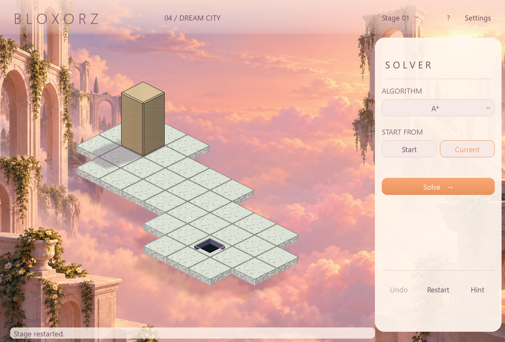
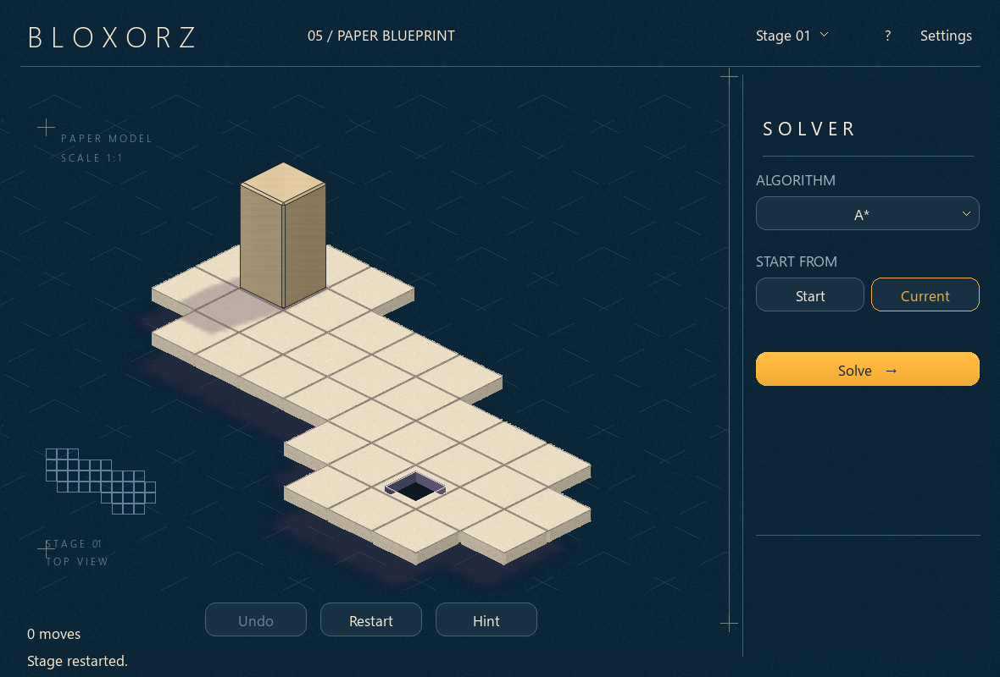
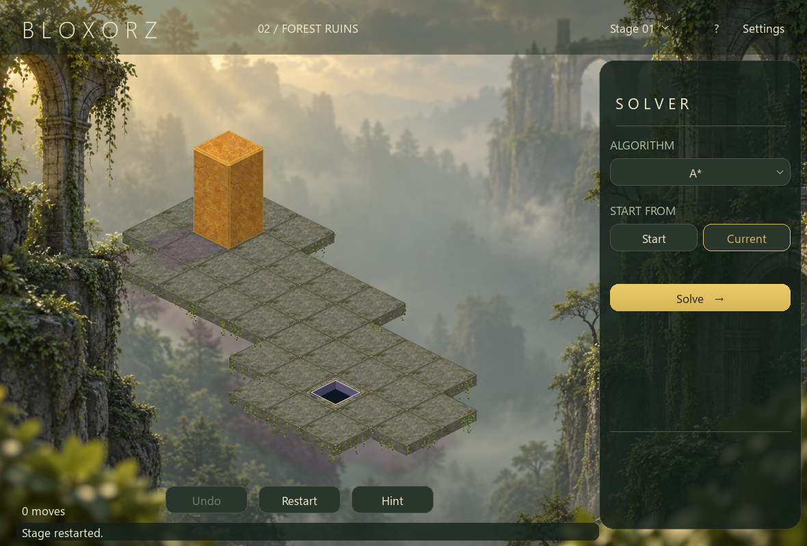

# Bloxorz: current screenshots

33 real-window captures: 11 states for each theme. All images live in this folder.
1180 × 800, except compact views at 960 × 720. Solver results come from the real worker.

| State | Dream City | Paper Blueprint | Forest Ruins |
|---|---|---|---|
| play | [Open](dream_01_play.png) | [Open](blueprint_01_play.png) | [Open](forest_01_play.png) |
| roll | [Open](dream_02_roll.png) | [Open](blueprint_02_roll.png) | [Open](forest_02_roll.png) |
| lying | [Open](dream_03_lying.png) | [Open](blueprint_03_lying.png) | [Open](forest_03_lying.png) |
| replay | [Open](dream_04_replay.png) | [Open](blueprint_04_replay.png) | [Open](forest_04_replay.png) |
| settings | [Open](dream_05_settings.png) | [Open](blueprint_05_settings.png) | [Open](forest_05_settings.png) |
| compact | [Open](dream_06_compact.png) | [Open](blueprint_06_compact.png) | [Open](forest_06_compact.png) |
| stage picker | [Open](dream_07_stage_picker.png) | [Open](blueprint_07_stage_picker.png) | [Open](forest_07_stage_picker.png) |
| algorithm menu | [Open](dream_08_algorithm_menu.png) | [Open](blueprint_08_algorithm_menu.png) | [Open](forest_08_algorithm_menu.png) |
| help | [Open](dream_09_help.png) | [Open](blueprint_09_help.png) | [Open](forest_09_help.png) |
| searching | [Open](dream_10_searching.png) | [Open](blueprint_10_searching.png) | [Open](forest_10_searching.png) |
| solution | [Open](dream_11_solution.png) | [Open](blueprint_11_solution.png) | [Open](forest_11_solution.png) |

## Dream

## Blueprint

## Forest

